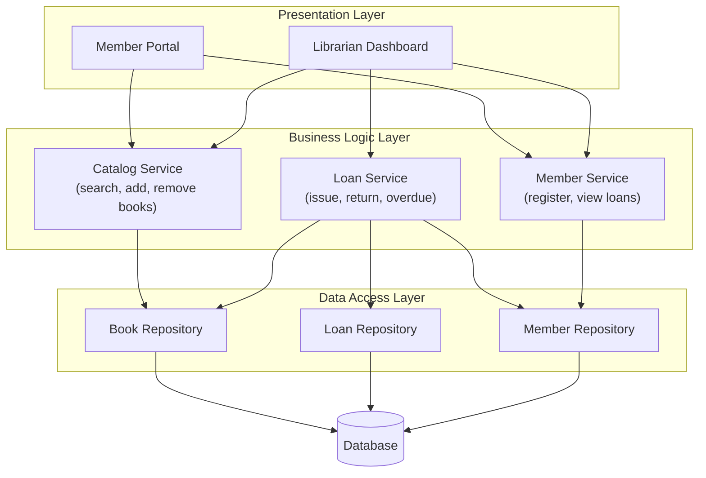
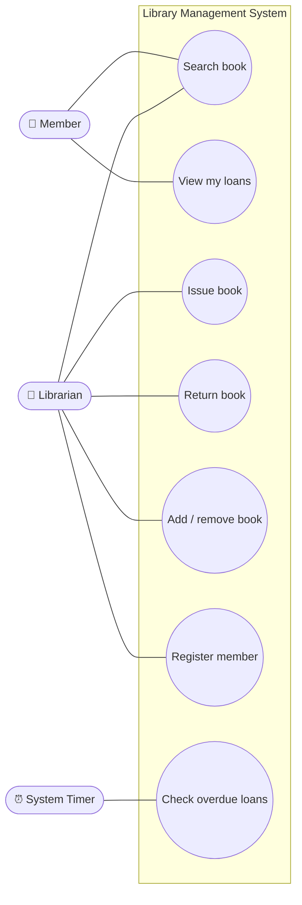
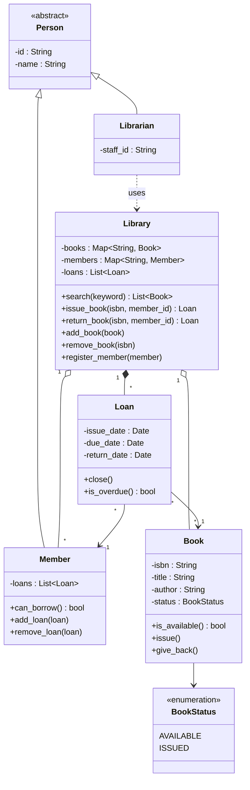
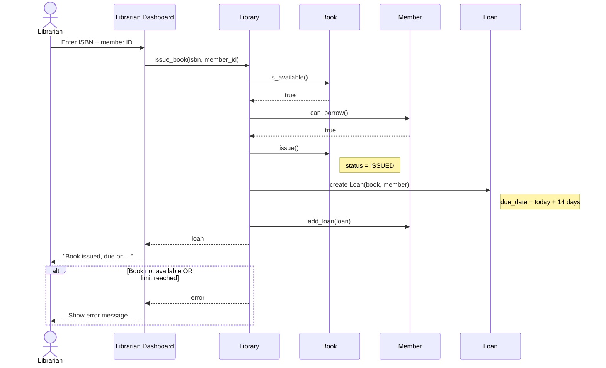
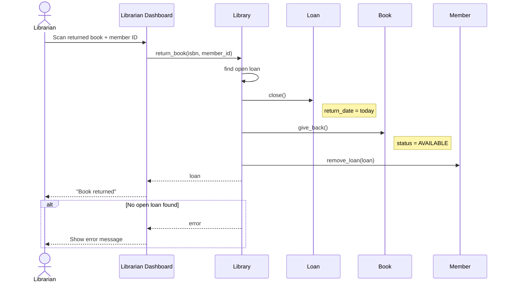
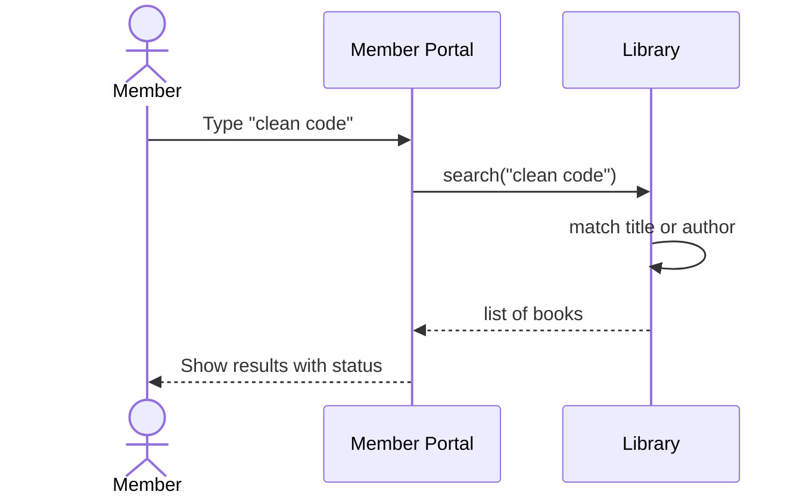
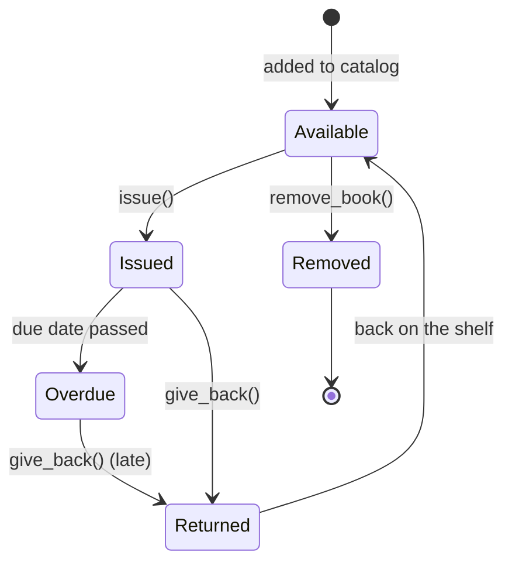
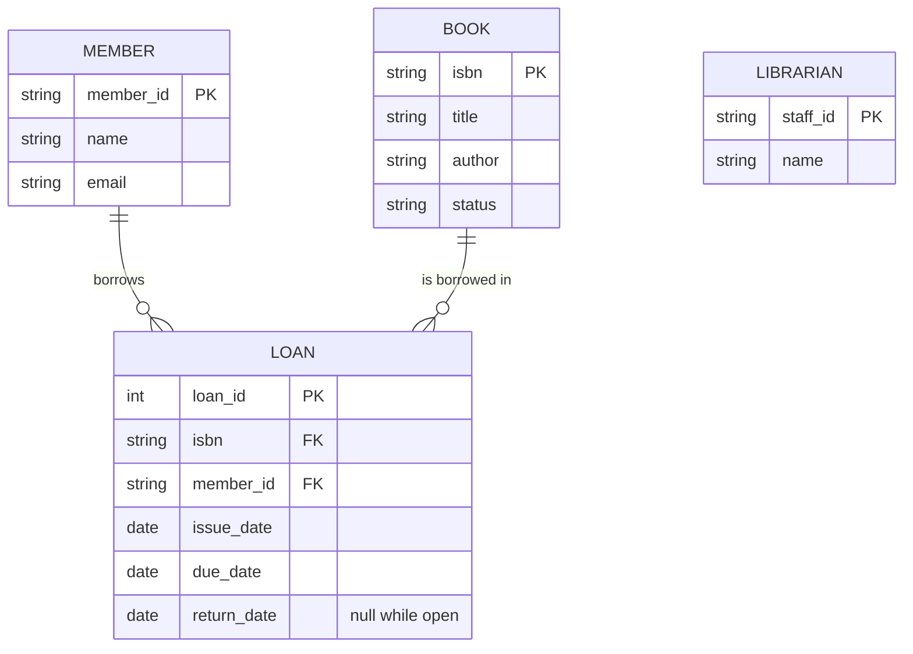
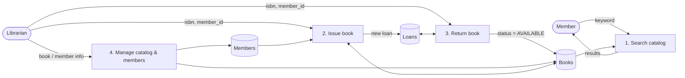
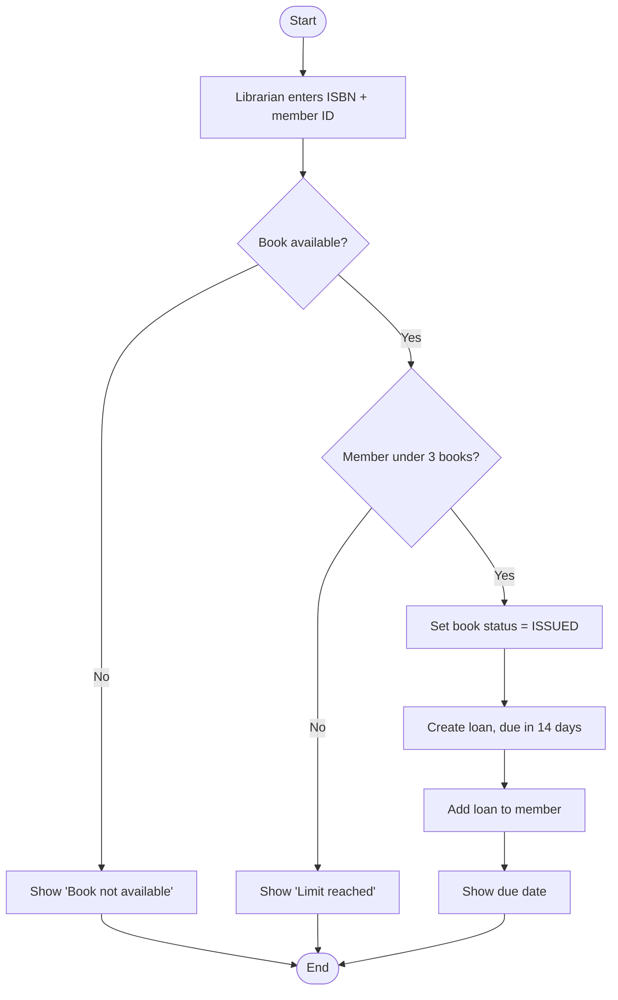

# Library Management System (LMS): Analysis & Modeling

A simplified library system for managing **books**, **members**, **borrowing/returning**, and **admin tasks**.
This document covers the analysis and design of the system.

> Diagrams are written in **Mermaid**. They render automatically on GitHub and in VS Code (with a Mermaid preview extension).

---

## 1. Requirement Analysis

### Actors

| Actor | Who they are | What they do |
|---|---|---|
| **Member** | A registered library user | Searches and borrows/returns books |
| **Librarian** | Library staff (admin) | Manages books and members, issues and returns books |
| **System (timer)** | Automatic | Marks loans as overdue |

### Key Use Cases

| # | Use case | Actor | Short description |
|---|---|---|---|
| UC1 | Search book | Member, Librarian | Find books by title or author |
| UC2 | Issue book | Librarian | Lend an available book to a member |
| UC3 | Return book | Librarian | Take a book back and close the loan |
| UC4 | Add / remove book | Librarian | Keep the catalog up to date |
| UC5 | Register member | Librarian | Create a new member account |
| UC6 | View my loans | Member | See borrowed books and due dates |
| UC7 | Check overdue loans | System | Flag loans past their due date |

### Business Rules
- A book can be lent to **only one member at a time**.
- A member can borrow **at most 3 books**.
- A loan lasts **14 days**.
- A book that is currently issued **cannot be removed**.

---

## 2. System Architecture

The system uses a classic **3-layer architecture**. Each layer talks only to the layer directly below it.

| Layer | Responsibility | Examples |
|---|---|---|
| **Presentation (UI)** | Shows screens and collects user input | Member portal, Librarian dashboard |
| **Business Logic** | Applies the library rules | `CatalogService`, `LoanService`, `MemberService` |
| **Data Access** | Saves and loads data | `BookRepository`, `MemberRepository`, `LoanRepository` |
| **Database** | Stores the data | Books, Members, Loans tables |

**Why layers?** The UI can change (web, mobile) without touching the rules, and the database can change without touching the UI.

---

## 3. Object-Oriented Analysis

### 3.1 Use Case Diagram

### 3.2 Classes (from the use cases)

| Class | Attributes | Methods | Responsibility |
|---|---|---|---|
| **Book** | isbn, title, author, status | `is_available()`, `issue()`, `give_back()` | Knows its own state |
| **Member** | member_id, name, loans | `can_borrow()`, `add_loan()`, `remove_loan()` | Knows its borrowing limit |
| **Librarian** | staff_id, name | uses `Library` | Performs admin actions |
| **Loan** | book, member, issue_date, due_date, return_date | `close()`, `is_overdue()` | Records one borrowing |
| **Library** | books, members, loans | `search()`, `issue_book()`, `return_book()`, `add_book()`, `remove_book()`, `register_member()` | Applies the rules and coordinates the objects |

**Design principles applied**
- **Single responsibility:** `Book` manages its status, `Loan` manages dates, `Library` manages the rules.
- **Encapsulation:** `status` and `loans` are private. They change only through methods like `issue()` and `add_loan()`, never directly.

### 3.3 Class Diagram

**Reading the diagram**
- A `Member` and a `Librarian` are both a kind of `Person` (inheritance).
- The `Library` holds many books, members and loans.
- Each `Loan` links exactly **one** book to **one** member.

### 3.4 Sequence Diagram: Issue Book (UC2)

### 3.5 Sequence Diagram: Return Book (UC3)

### 3.6 Sequence Diagram: Search Book (UC1)

### 3.7 State Diagram: Book

| State | Meaning |
|---|---|
| **Available** | On the shelf, can be borrowed |
| **Issued** | Lent to a member |
| **Overdue** | Still issued after the due date |
| **Returned** | Brought back, checked by the librarian |
| **Removed** | Taken out of the catalog (only possible when Available) |

> The `Book` class stores only `AVAILABLE` / `ISSUED`. **Overdue** is known from the loan's due date, and **Returned** is the short step before going back to `AVAILABLE`.

---

## 4. Data, Functional and Behavioral Models

### 4.1 Data Model: how data is structured (ERD)

- One member can have **many** loans; one book can appear in **many** loans over time.
- A loan is **open** while `return_date` is empty.

### 4.2 Functional Model: what the system does (Data Flow Diagram)

| Function | Input | Output |
|---|---|---|
| Search catalog | keyword | list of matching books |
| Issue book | isbn, member_id | new loan (or error) |
| Return book | isbn, member_id | closed loan, book available again |
| Manage catalog | book / member data | updated catalog / member list |

### 4.3 Behavioral Model: how the system behaves over time (Activity Diagram: Issue Book)

The **state diagram** (section 3.7) and the **sequence diagrams** (sections 3.4–3.6) are also part of the behavioral model.

---

## 5. Summary

| Requirement | Where |
|---|---|
| Actors & use cases | Section 1 |
| Architecture + diagram | Section 2 |
| Classes + class diagram | Sections 3.2, 3.3 |
| Use case diagram | Section 3.1 |
| Sequence diagrams (3 use cases) | Sections 3.4, 3.5, 3.6 |
| Book state diagram | Section 3.7 |
| Data / functional / behavioral models | Section 4 |
